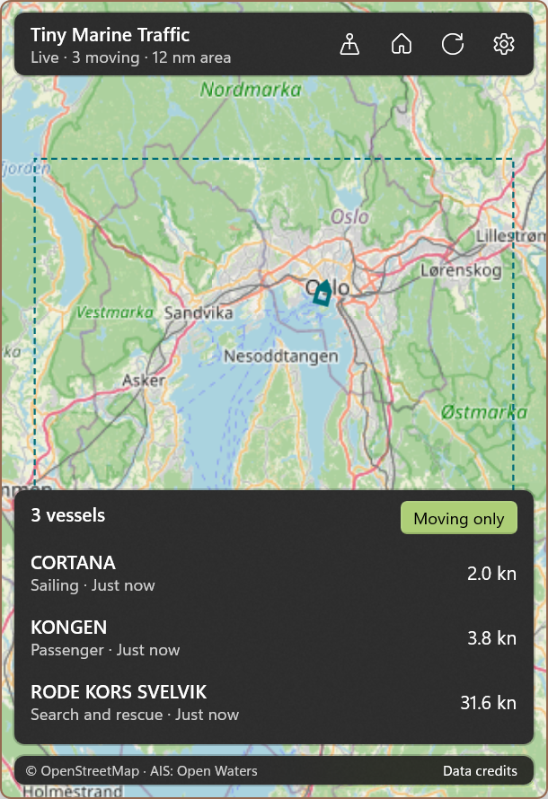

# Tiny Marine Traffic

A small window onto your favorite waterway, right in the Windows notification area.



Inspired by [Tiny ATC](https://github.com/Tray-Land/tiny-atc), with a native map and real vessel reports from [Open Waters AIS](https://openwaters.io/api/ais/). No browser engine, account, or API key.

## What it does

- **Harbor map:** **Moving only** is checked by default. Ship silhouettes follow reported heading or course. Teal ships are moving at 1 knot or more; uncheck the filter to also show gray ships that are slower or have no reported speed. The orange ship is selected.
- **Live traffic:** an initial snapshot followed by an AIS WebSocket stream. Reports older than 30 minutes disappear; positions are not extrapolated or presented as guaranteed current locations.
- **Vessel details:** select a ship on the map or in the keyboard-accessible list for name, MMSI, vessel type, speed in knots, course, navigation status, coordinates, distance from the area center, report age, source, and reported destination.
- **Change places on demand:** the header's location-pin button opens **Change place**, with the waterway picker and **Save area**. These controls stay out of the way until requested; choosing a waterway, pressing Escape, or clicking outside dismisses them.
- **Pick and save an area:** open **Change place**, choose **Save area**, tap a spot or pan the map under the crosshair, then zoom to frame the area. Give it a name and leave **Make this my home area** checked to make it home. The dashed outline previews the saved coverage (2–50 nautical-mile half-width); panning alone does not change the traffic subscription.
- **Your home and saved spots:** the Home button restores your saved center and zoom, and each new app session starts at home. Oslofjord is the initial home, with Bergen, Helsinki, Rotterdam, the English Channel, Puget Sound, San Francisco Bay, and New York Harbor also included. In **Settings**, edit the dropdown's names, coordinates, and range with **Save changes**, add areas, choose a different home, or delete areas with confirmation. Up to 30 areas can be saved.
- **Small and quiet:** clicking the tray icon toggles the flyout; right-click offers Open, Settings, and Exit. Escape closes vessel details first, returns from Settings, then hides the flyout. The icon follows the Windows taskbar's light/dark theme.
- **Opt-in startup:** enable Start with Windows in Settings. Startup restrictions from Windows or organization policy are explained rather than overridden.

The flyout light-dismisses when you switch apps. Settings live inside it, not in another window. Launching the app again opens the existing instance.

**Not for navigation.** AIS coverage depends on receivers and can be incomplete, delayed, or wrong. A reported destination is not a verified route or ETA. The OpenStreetMap basemap is not a nautical chart.

## Install

No release has been published yet. Build from source below, or create a bundle with `build-msix-for-gh.ps1`.

Releases are designed to provide one signed x64 + ARM64 `.msixbundle` and a [TinyMarineTraffic.appinstaller feed](https://github.com/Tray-Land/tiny-marine-traffic/releases/latest/download/TinyMarineTraffic.appinstaller), available after the first stable release. The feed selects the matching architecture, installs the Windows App Runtime dependency, and enables update checks on launch and in the background. Self-signed releases require trusting the publisher's signing certificate before sideloading.

Requirements: Windows 10 1809 (build 17763) or later, x64 or ARM64.

## Setup and privacy

No setup or key is needed. Open Waters supports anonymous, personal-use access. Every subscribed area is below its anonymous 100-square-degree limit, including areas that cross the antimeridian.

The app contacts `ais.openwaters.io` for one HTTP snapshot and a live WebSocket subscription **only while the traffic page is visible**. Entering Settings or hiding the flyout cancels the connection and stops retries. OpenStreetMap tiles come from `tile.openstreetmap.org`; the basemap layer is detached when hidden. Requests already in flight may finish.

Offline or interrupted connections keep the last reports visible, show an inline warning, and retry with exponential backoff up to ten minutes. HTTP rate limits respect `Retry-After`. There is no background traffic tracking, device-location request, telemetry, or sign-in.

Named areas, their coordinates/range and map zoom, the home area, and the selected area are stored in `areas.json` in the package's local app-data folder. Writes replace the file atomically. The first-launch flag is stored in Windows LocalSettings; an older custom location is migrated into the saved-area list. Vessel reports are kept in memory, not on disk. No user secrets are collected or stored. Diagnostic crash logs go to `%TEMP%\TinyMarineTraffic-crash.log`.

After one minute hidden, the flyout closes, releases its map and subscriptions, and trims idle memory. Windows App Installer may independently check for application updates when installed through a published feed.

## Build from source

Install the [.NET 10 SDK](https://dotnet.microsoft.com/download), enable Developer Mode, and install [WinApp CLI](https://github.com/microsoft/WinAppCli) 0.7 or later:

```powershell
winget install Microsoft.WinAppCli
winapp run .\TinyMarineTraffic.csproj --detach
winapp run .\TinyMarineTraffic.csproj -c Release --detach
dotnet test .\TinyMarineTraffic.Tests\TinyMarineTraffic.Tests.csproj
```

The first run opens the flyout. Afterward, look for the boat icon in the tray overflow if it is not pinned. `winapp run --clean` resets first-run settings. `OAuth.resw.sample` is an unused scaffold placeholder; this app needs no `OAuth.resw` secrets.

For the UI batch, open the flyout and use its current PID from the window listing:

```powershell
winapp ui list-windows -a TinyMarineTraffic --json
.\scripts\Test-UI.ps1 -AppPid <PID> -AppScope local -Target local -ArtifactDirectory "$env:TEMP\TinyMarineTraffic-ui"
```

The batch exercises live data, ship selection, filtering, tapping/zooming the map to save home, home recall, settings add/rename/edit/delete, duplicate-name validation, persistence, Escape navigation, and accessible control names. It removes its temporary areas and restores the original home when successful. Use a fresh evidence directory for each run.

## Packaging

Windows App SDK **Base, Foundation, InteractiveExperiences, WinUI, and Runtime** are pinned to the versions actually restored. AI, ML, Search, Widgets, and DWrite are not referenced, and WebView2 is excluded. The app uses a framework-dependent Windows App SDK with a self-contained .NET runtime. Bump component versions explicitly when upgrading.

Measured unsigned Release x64 package sizes for this implementation (decimal MB):

| Package | Bytes | MB |
|---|---:|---:|
| Initial Windows App SDK metapackage baseline | 38,180,960 | 38.18 |
| Current required-components build | 20,512,219 | 20.51 |

That is a **46.3% reduction** from the initial baseline, including the newer saved-area features in the current build. The largest removed files are `onnxruntime.dll` (21,659,280 bytes) and `DirectML.dll` (18,700,224 bytes), followed by the Windows ML and WebView2 binaries. These are app-package measurements, excluding the separately installed Microsoft Windows App Runtime framework.

The release script is adapted from Tiny ATC. It writes the App Installer feed first, embeds the same bytes into each architecture's package, restores release-only manifest edits in `finally`, and checks the bundle identities, architectures, block maps, feed equality, and framework dependency assets.

To check unsigned artifacts locally without a GitHub remote, tagging, signing, or uploading:

```powershell
.\build-msix-for-gh.ps1 -SkipRelease -NoSign `
    -Repository Tray-Land/tiny-marine-traffic `
    -OutputDirectory "$env:TEMP\TinyMarineTraffic-packages"
```

For a real release, configure the correct GitHub `origin`, commit and push the source, bump `Package.appxmanifest`'s version, then run `.\build-msix-for-gh.ps1` from a PowerShell session with the maintainer's `sign-msix` function. It signs only the app bundle, preserves Microsoft's framework signatures, and creates a **draft** GitHub release. Publish a stable release to activate the `latest/download` feed. Differential update behavior requires two published versions and has not been verified here.

## Data and credits

Open Waters AIS is for personal use under its [API terms and limits](https://openwaters.io/api/ais/). Receiver coverage and upstream licenses vary. **Data credits** in the flyout retains the attribution delivered by both snapshots and live events.

Map: [© OpenStreetMap contributors](https://www.openstreetmap.org/copyright). Tiles are requested on demand with the app's User-Agent; there is no bulk or offline download.

Native rendering uses [WinUIEx.Maps](https://github.com/dotMorten/WinUIEx.Maps), which is free for non-commercial use; check its license and author-sponsorship requirements before commercial distribution. The tray architecture and release tooling follow [Tiny ATC](https://github.com/Tray-Land/tiny-atc) and the shared WinUI tray scaffold.

## License

MIT, see [LICENSE](LICENSE).
